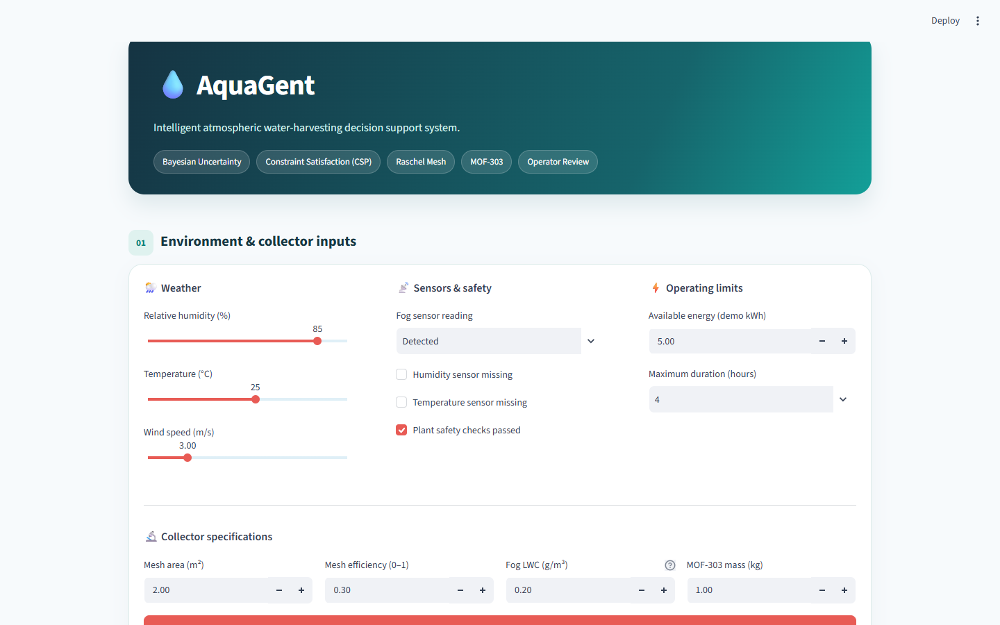
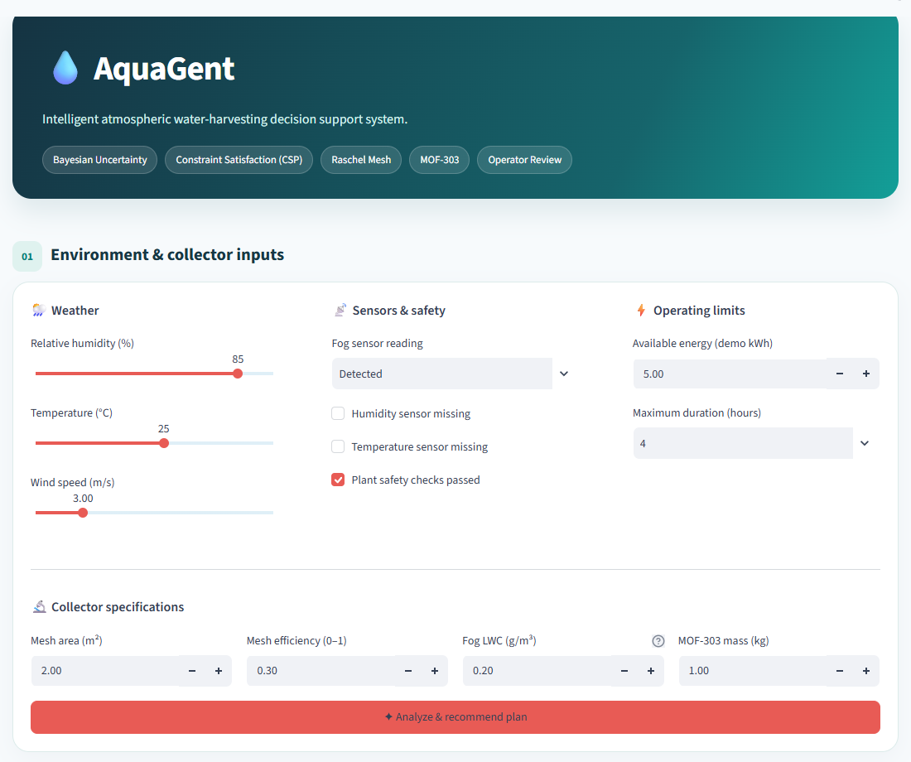
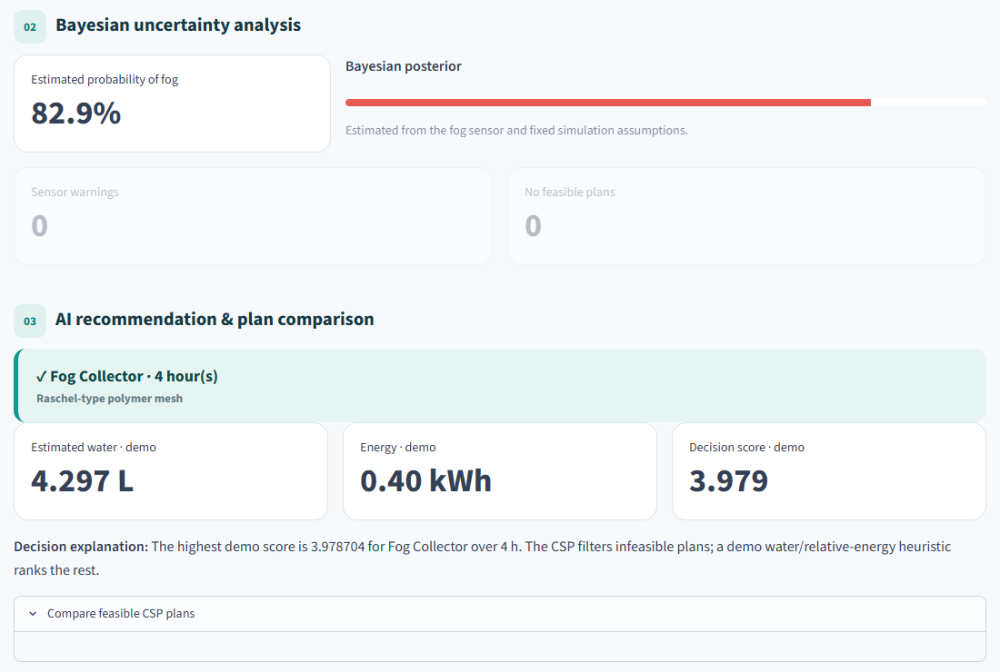
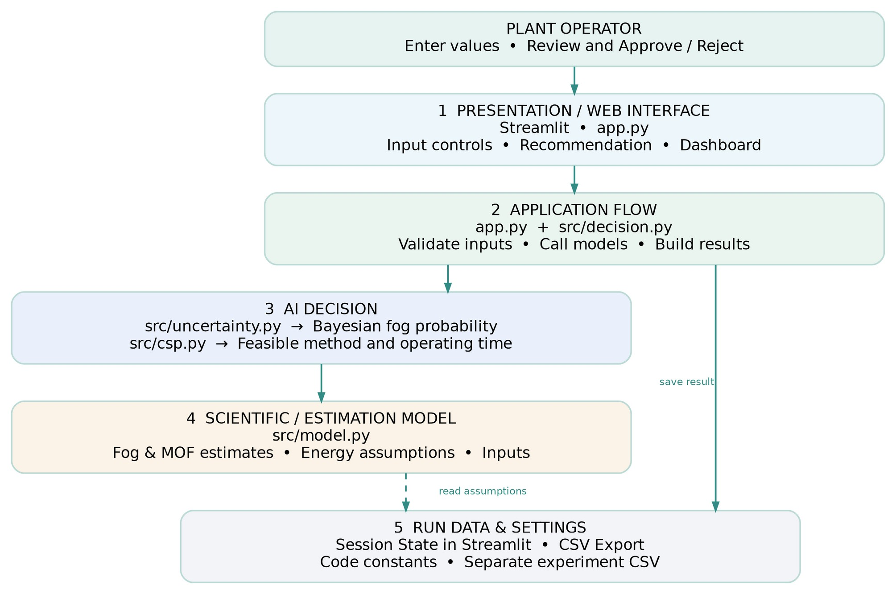
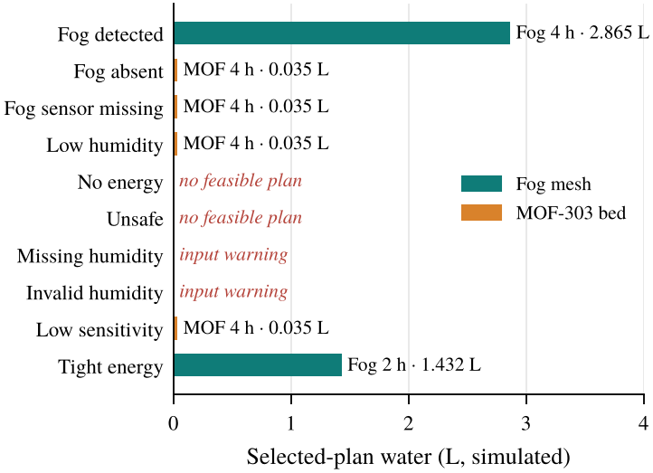
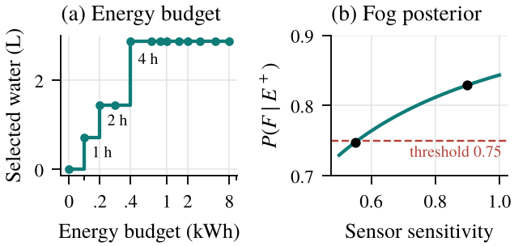
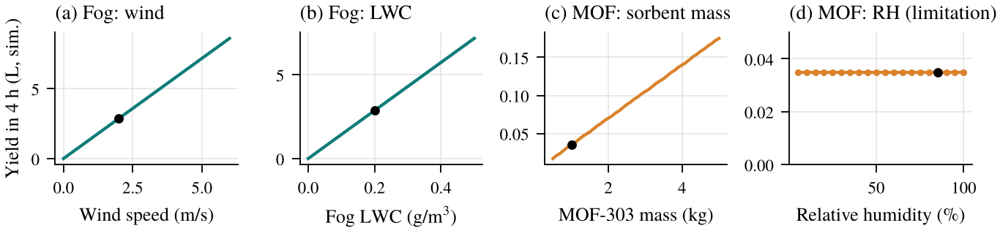

# 💧 AquaGent

**An explainable decision-support agent that chooses between a fog collector, a MOF-303 sorbent bed, or no plan — when weather evidence is uncertain and energy is limited.**


CS3081 Artificial Intelligence · Effat University · Fall 2026 · Instructor: Dr. Naila Marir

**[🌐 Interactive demo](https://zalameri.github.io/aquagent/)** · **[📁 Portfolio case study](https://zalameri.github.io/project.html?p=aquagent)** · **[📄 Technical report (PDF)](report/AquaGent_ACL_Report.pdf)**

> All water and energy values are **simulation estimates** from stated assumptions. They are not field measurements and must not be used for real equipment decisions.

---

## 📸 Preview



| Inputs | Recommendation |
|---|---|
|  |  |

---

## 🎯 Problem

Water can be collected from air in two very different ways. A **fog mesh** catches droplets that are already in the air, so it needs fog and wind. A **MOF-303 sorbent bed** adsorbs water vapour and needs energy to release it. Humidity alone cannot tell an operator which one to run.

> **Research question:** How can an agent choose a fog collector, a MOF bed, or no safe option when weather evidence is uncertain and resources are limited?

**Adversarial challenge (course theme: agents under adversarial conditions)**

| Challenge | Where it appears | How AquaGent handles it |
|---|---|---|
| **Noisy observations** | The fog sensor can report fog that is not there, or miss real fog | A Bayesian update weighs the reading by the sensor's sensitivity and specificity; fog is allowed only if P(fog) ≥ 0.75 |
| **Incomplete knowledge** | The fog reading or the humidity value can be missing or invalid | A missing fog reading keeps the prior and raises a warning; invalid inputs stop the agent with `SENSOR_WARNING` |

---

## ✨ Core features

- **Bayesian fog probability** that accounts for sensor accuracy — no invented readings when the sensor is missing
- **Backtracking CSP** over harvesting method × duration with safety, time, energy and weather constraints
- **Explainable output:** ranked feasible plans plus the exact rules that rejected every other method
- **Safe refusals:** `NO_FEASIBLE_METHOD` when nothing is safe, `SENSOR_WARNING` when inputs are invalid
- **Human in the loop:** the operator approves or rejects; the agent never controls equipment
- **Run history and CSV export** in the Streamlit dashboard
- **Reproducible evaluation:** 45 unit tests, 10 scenarios and sensitivity sweeps from one script

---

## 🏗️ Architecture



| Layer | Files | Responsibility |
|---|---|---|
| 1 · Presentation | `app.py` (Streamlit) | Inputs, recommendation, dashboard, approve / reject |
| 2 · Application flow | `app.py`, `src/decision.py` | Build `Inputs`, validate, call the models, collect results |
| 3 · AI decision | `src/uncertainty.py`, `src/csp.py` | Bayesian fog probability; feasible (method, hours) plans |
| 4 · Scientific model | `src/model.py` | Fog and MOF water estimates, energy assumptions |
| 5 · Run data | Streamlit session, CSV export | History of runs and decisions |

**Agent type:** model-based, goal- and utility-driven. **Environment:** partially observable, stochastic, episodic, static, discrete, single agent with a human operator.

---

## 🧠 How the agent decides

**1 · Bayesian sensor model** (`src/uncertainty.py`)

$$P(F \mid E^{+}) = \frac{s\,\pi}{s\,\pi + (1-c)(1-\pi)}$$

Defaults: prior π = 0.35, sensitivity s = 0.90, specificity c = 0.90 (assumptions). A positive reading gives P(fog) = 0.829; a negative one gives 0.057.

**2 · Backtracking CSP** (`src/csp.py`) over method ∈ {Fog, MOF} and hours ∈ {1, 2, 4, 8}

| Constraint | Applies to |
|---|---|
| Safety inspection passed | both |
| hours ≤ maximum hours | both |
| hours × rate ≤ energy budget (rates 0.10 and 1.20 kWh/h, demo values) | both |
| P(fog) ≥ 0.75, wind > 0, fog LWC > 0 | fog collector |
| RH > 0 | MOF bed |

**3 · Estimate and rank** (`src/model.py`, `src/decision.py`)

$$L_{\text{fog}} = 3.6 \cdot \text{LWC} \cdot v \cdot A \cdot \eta \cdot H \cdot P(F \mid E) \qquad L_{\text{MOF}} = 0.210 \cdot m_{\text{MOF}} \cdot H / 24 \qquad S = \frac{L}{1 + E / E_{\text{budget}}}$$

The MOF rate (0.210 L per kg per day) is the Death Valley field result of Song et al. (2023), scaled by hours as a classroom simplification. Ties in *S* go to the plan that uses less energy.

---

## 🚀 Quick start

Requires **Python 3.10+**.

```bash
git clone https://github.com/Zalameri/aquagent.git
cd aquagent
python -m pip install -r requirements.txt

python -m streamlit run app.py          # dashboard at http://localhost:8501
```

On Windows PowerShell the same commands work; use `py` instead of `python` if needed.

---

## 🧪 Tests and experiments

```bash
python -m unittest discover -s tests -v        # 45 unit tests
python -m experiments.run_simulation           # 10 scenarios → experiments/results.csv
python analysis/generate_analysis.py           # scenarios + sensitivity sweeps → analysis/data/*.csv
python analysis/make_report_figures.py         # report figures → report/source/figures/
```

| Scenario | P(fog) | Result | Water (L, sim.) | Energy (kWh) |
|---|---:|---|---:|---:|
| Fog detected | 0.829 | Fog 4 h | 2.865 | 0.4 |
| Fog absent | 0.057 | MOF 4 h | 0.035 | 4.8 |
| Fog sensor missing | 0.350 | MOF 4 h (warning) | 0.035 | 4.8 |
| Low humidity (30%) | 0.057 | MOF 4 h | 0.035 | 4.8 |
| No energy | 0.829 | `NO_FEASIBLE_METHOD` | — | — |
| Unsafe | 0.829 | `NO_FEASIBLE_METHOD` | — | — |
| Missing humidity | — | `SENSOR_WARNING` | — | — |
| Invalid humidity (120%) | — | `SENSOR_WARNING` | — | — |
| Low sensitivity (s = 0.55) | 0.748 | MOF 4 h | 0.035 | 4.8 |
| Tight energy (0.2 kWh) | 0.829 | Fog 2 h | 1.432 | 0.2 |

The 10 scenarios are hand-designed test cases, not a statistical sample, so no "accuracy" is reported from them. The 45/45 figure is a software test pass count.

---

## 📊 Results

| Scenario outcomes | Energy budget and sensor reliability |
|---|---|
|  |  |



**Key findings**

1. **Bayesian evidence decides when fog can be trusted.** With sensitivity 0.55 the posterior is 0.748, just under the 0.75 threshold, so the agent switches to MOF. A "yes" reading only passes the threshold when sensitivity ≥ 0.557.
2. **The CSP shapes the plan in discrete steps.** 0 kWh → no plan; 0.1 kWh → fog 1 h; 0.2–0.3 kWh → fog 2 h; ≥ 0.4 kWh → fog 4 h (the 4 h limit then binds).
3. **The agent refuses instead of guessing** when inputs are missing or invalid, or when no plan is safe.

---

## ⚠️ Limitations

- The prior, sensor sensitivity/specificity, threshold and energy rates are **assumptions**, not calibrated values.
- The fog equation is linear and uses an assumed liquid-water content and mesh efficiency.
- The MOF model scales one daily field result by hours; it has **no humidity-dependent isotherm**, so its yield is flat in RH (see the sensitivity figure, panel d).
- Fog (2 m²) and MOF (1 kg) are not matched in size, so the ranking does not show that one technology is better.
- Inputs are entered by hand; there are no live sensors. Details: [`docs/SCIENTIFIC_ASSUMPTIONS.md`](docs/SCIENTIFIC_ASSUMPTIONS.md).

---

## 📁 Repository structure

```
aquagent/
├── app.py                      Streamlit dashboard (inputs, recommendation, approval, CSV export)
├── src/
│   ├── model.py                inputs, validation, fog and MOF-303 estimates
│   ├── uncertainty.py          Bayesian fog posterior
│   ├── csp.py                  constraints and backtracking search
│   └── decision.py             agent pipeline, scoring, explanations
├── tests/                      45 unit tests
├── experiments/                10 reproducible scenarios + results.csv
├── analysis/
│   ├── generate_analysis.py    scenarios and sensitivity sweeps → data/*.csv
│   ├── make_report_figures.py  report figures from the CSV files
│   ├── data/                   scenario_results, sensitivity_values, energy_budget_sensitivity
│   └── figures/                quick-look charts
├── report/
│   ├── AquaGent_ACL_Report.pdf technical report (ACL format, 8 pages)
│   └── source/                 LaTeX source (ACL template), bibliography, figures
├── docs/                       AI methods, scientific assumptions, changelog, screenshots
├── assets/                     README images
└── requirements.txt
```

---

## 📄 Documents

| Document | Link |
|---|---|
| Technical report (ACL format) | [report/AquaGent_ACL_Report.pdf](report/AquaGent_ACL_Report.pdf) |
| Report LaTeX source | [report/source/](report/source/) (upload the folder to Overleaf to rebuild) |
| AI methods | [docs/AI_METHODS.md](docs/AI_METHODS.md) |
| Scientific assumptions | [docs/SCIENTIFIC_ASSUMPTIONS.md](docs/SCIENTIFIC_ASSUMPTIONS.md) |
| Interactive demo and case study | [zalameri.github.io/aquagent](https://zalameri.github.io/aquagent/) |

---

## 👥 Team

| Member | Contribution |
|---|---|
| **Zainab Alameri** ([@Zalameri](https://github.com/Zalameri)) | Equal share — all parts done jointly |
| **Abubaker Baobaid** | Equal share — all parts done jointly |

Both members worked together on every part of the project — literature review, agent design, Bayesian model, CSP, interface, tests, experiments and report — and shared the work equally.

---

## 📚 References and acknowledgements

- Song, W. et al. (2023). MOF water harvester produces water from Death Valley desert air in ambient sunlight. *Nature Water*, 1, 626–634.
- Alzahrani, A. S. & Abdelbaki, A. M. (2025). Fog harvesting implementation as a sustainable water source: a feasibility study in Al-Baha, Saudi Arabia. *J. Umm Al-Qura Univ. Eng. Arch.*
- Russell, S. & Norvig, P. (2021). *Artificial Intelligence: A Modern Approach*, 4th ed. Pearson.
- Full reference list in the [technical report](report/AquaGent_ACL_Report.pdf).

Built with Python, Streamlit, NumPy and Matplotlib. Literature search with Elicit. Use of generative AI assistance is declared in the technical report, as required by the course's academic-integrity policy.
